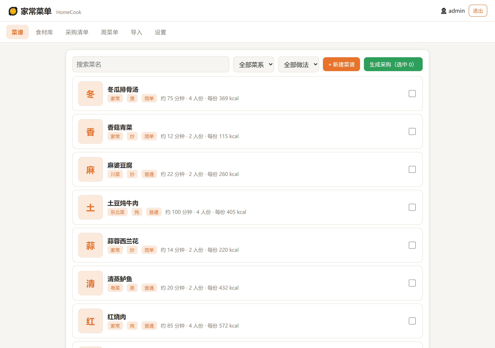
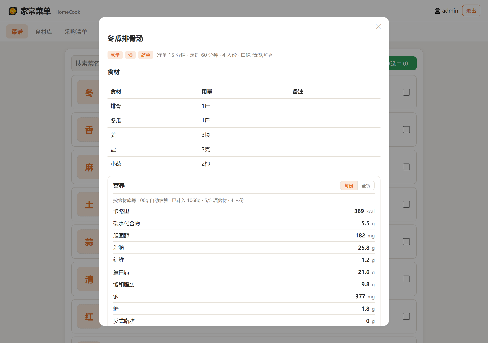
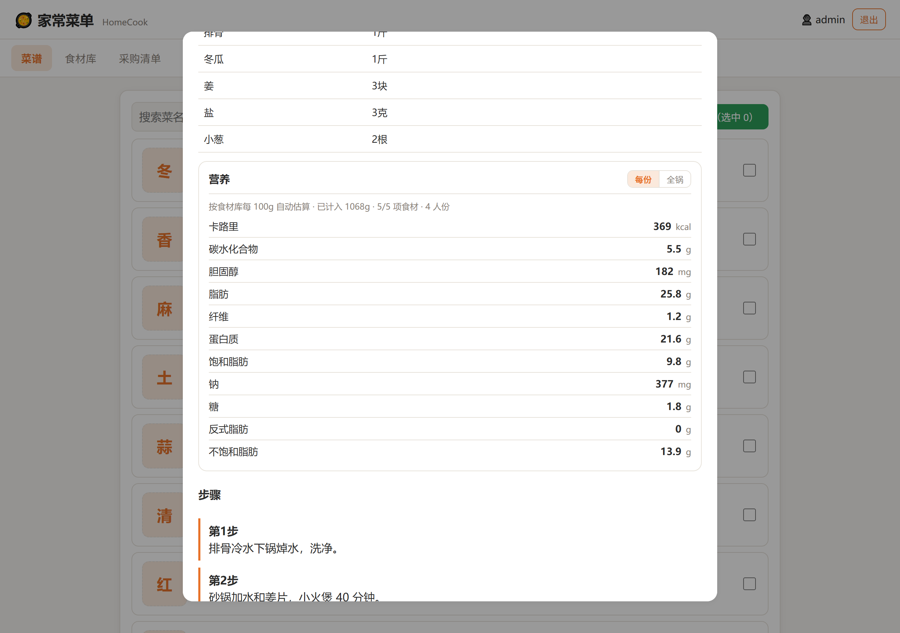
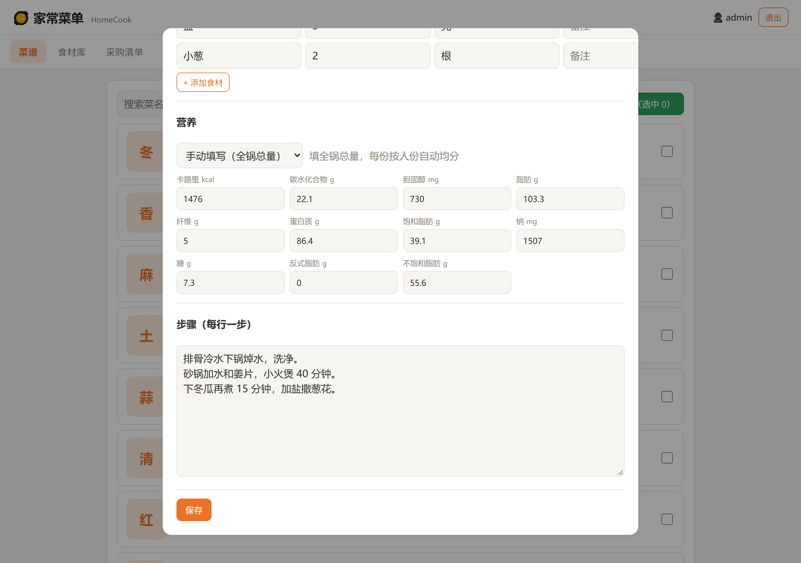
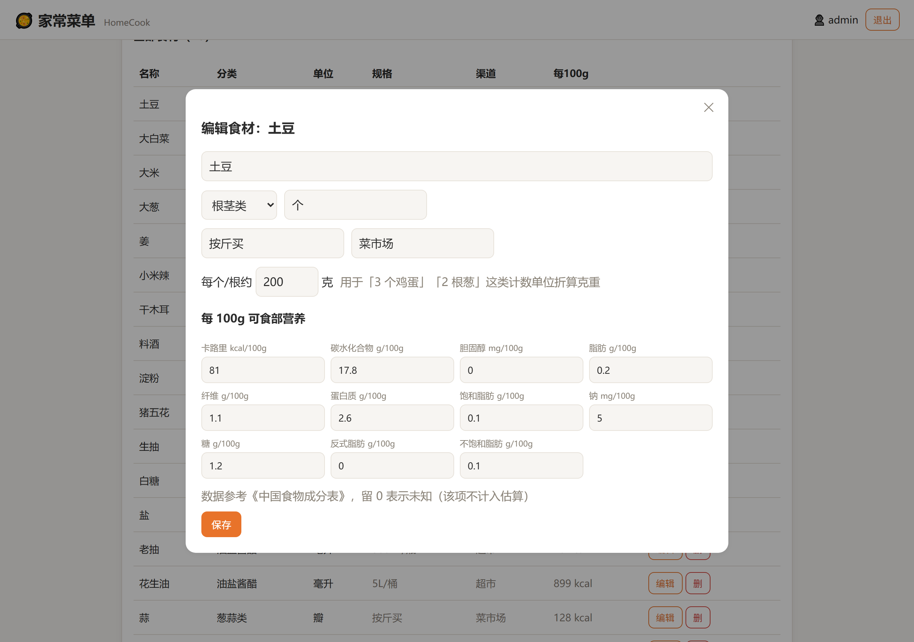
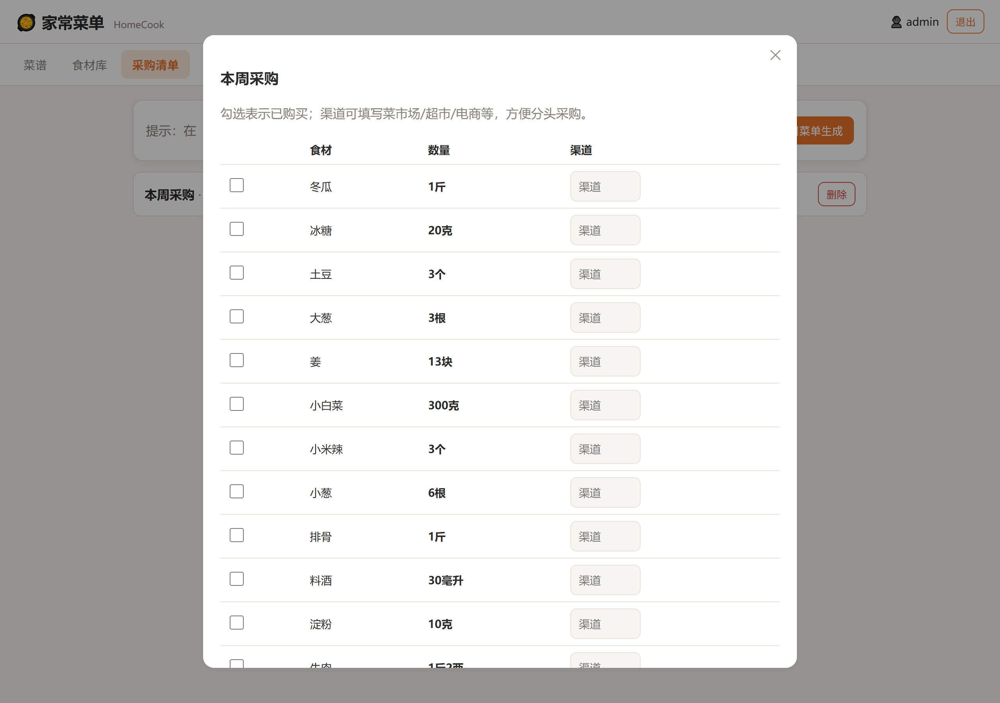
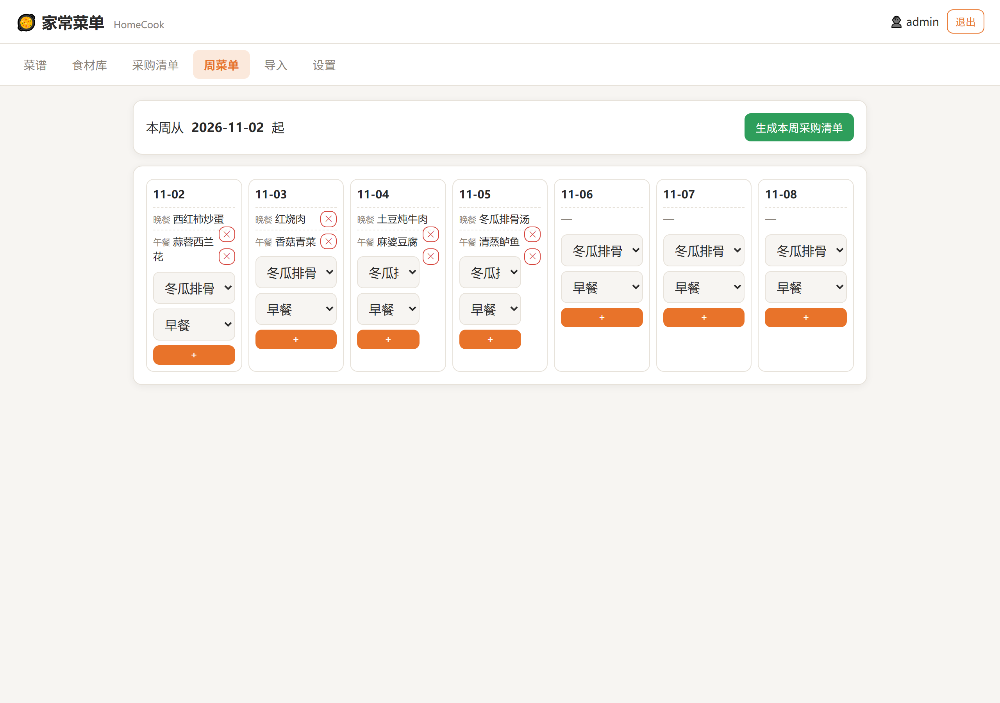
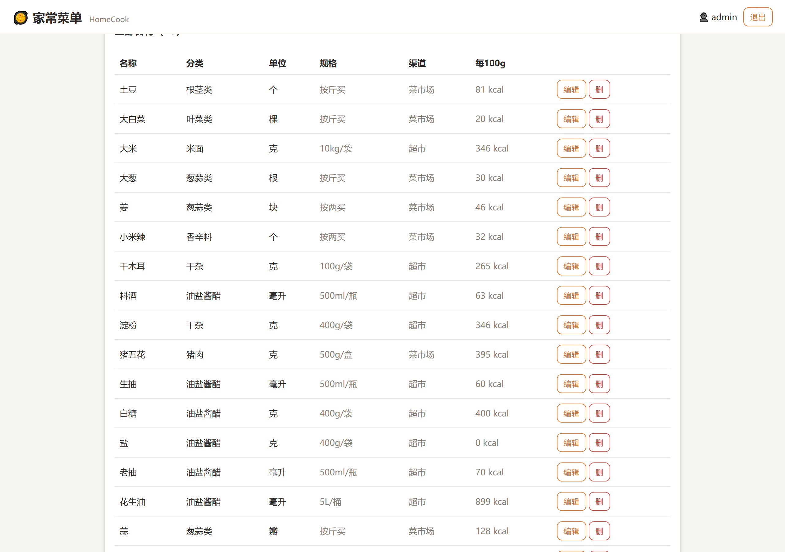
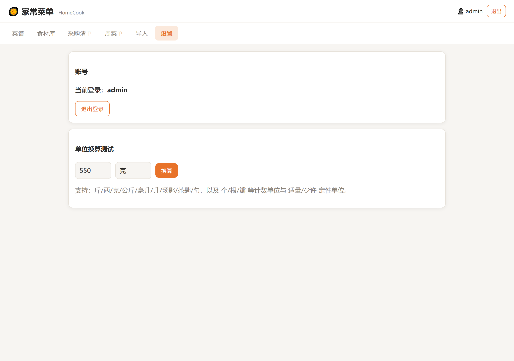

# 家常菜单 HomeCook

一套面向中式家庭饮食的菜单管理应用，参照 Mealie 的思路但针对国内习惯重写：
中式食材分类、家常菜谱结构、本地单位（斤/两/克/汤匙）与采购方式（菜市场/超市/电商/社区团购）。

- 源码仓库：https://github.com/mjy378283319/homecook
- 容器镜像：`ghcr.io/mjy378283319/homecook:latest`（多架构 amd64 / arm64，push 后由 GitHub Actions 自动构建）
- 与 `xcf2mealie_web` **完全独立**：HomeCook 自带下厨房导入，不依赖 Mealie。

## 界面预览

 

 

 

 

 

## 与 Mealie 的差异（本地化重点）

| 维度 | Mealie（国外习惯） | HomeCook（本地化） |
|------|-------------------|-------------------|
| 食材分类 | 通用 pantry 标签 | 中式分类树：蔬菜/肉禽蛋/水产/主食杂粮/豆制品/调料干货… |
| 单位 | cup/oz/g 为主 | 斤、两、克、公斤、汤匙、茶匙、个、瓣、适量、少许… |
| 采购 | 单一清单 | 同种食材自动合并，按斤两/毫升聚合，可填采购渠道 |
| 菜谱结构 | 步骤 + 食材 | 额外支持菜系、做法、口味标签、准备/烹饪时长、整体小贴士 |
| 导入 | 多国站点 | 下厨房（xiachufang.com）尽力解析，导入前可复核编辑 |

## 功能模块

1. **菜谱管理**：菜系/做法/难度/人份/时长/口味标签/小贴士；食材明细（本地单位）；分步做法（每步可带提示）。
2. **封面图**：列表缩略图 + 详情大图；支持本地上传或粘贴图片链接；下厨房导入时自动抓成品图；无图时显示菜名首字占位。
3. **营养**：11 项指标（卡路里/碳水/胆固醇/脂肪/纤维/蛋白质/饱和脂肪/钠/糖/反式脂肪/不饱和脂肪），按食材每 100g 自动估算，可切换每份/全锅，也可手动覆盖。
4. **食材库**：中式分类树 + 别名字典；记录默认单位、采购规格、常去渠道、每 100g 营养与单件克重。
5. **采购清单**：从勾选菜谱或周菜单一键聚合；按名称合并、按斤两/毫升换算展示；可勾选已购、填采购渠道。
6. **周菜单**：一周早/午/晚排菜，按区间生成采购清单。
7. **单位换算**：斤↔两↔克、升↔毫升、汤匙↔茶匙，以及定性单位（适量/少许）。
8. **导入**：粘贴下厨房链接，尽力解析用料与步骤后进入可编辑表单。
9. **鉴权**：独立登录页（支持 Bitwarden 自动填充），写入 httpOnly 会话 Cookie；读操作开放，写操作需登录。
10. **深链**：支持 `#recipes` / `#shopping` / `#mealplan` 等地址直接进入对应标签页，可收藏。

## 技术栈

- 后端：FastAPI + SQLAlchemy + SQLite
- 前端：原生 JS 单页应用（无构建步骤，可离线运行）
- 部署：Docker / docker-compose，数据持久化于 `/data` 卷

## 数据模型（核心表）

- `users` 账号
- `categories` 食材分类树（parent_id 自引用）
- `ingredients` 食材（关联分类、别名、默认单位、采购规格、渠道；11 项每 100g 营养 + 单件克重）
- `recipes` 菜谱（菜系/做法/难度/时长/口味/小贴士/来源；营养口径 `nutrition_mode` + 11 项手填总量）
- `recipe_ingredients` 菜谱食材（数量、单位、备注，可关联食材或自由文本）
- `recipe_steps` 步骤（序号、标题、正文、提示）
- `meal_plans` 周菜单（日期、餐别、菜谱）
- `shopping_lists` / `shopping_items` 采购清单及条目

## 快速开始

```bash
docker run -d --name homecook \
  -p 9926:8000 \
  -v /mnt/user/appdata/homecook:/data \
  -e WEB_USER=admin \
  -e WEB_PASSWORD='换成你的强密码' \
  -e SECRET_KEY="$(openssl rand -hex 32)" \
  -e TZ=Asia/Shanghai \
  --restart unless-stopped \
  ghcr.io/mjy378283319/homecook:latest
# 访问 http://<主机IP>:9926
```

或使用 compose：

```bash
docker compose up -d        # 直接从 ghcr 拉取镜像
```

本地开发构建（改代码后）：

```bash
docker build -t ghcr.io/mjy378283319/homecook:latest .
docker compose up -d
```

> ⚠️ 部署前务必修改 `WEB_PASSWORD` 与 `SECRET_KEY`，不要把默认口令暴露到公网。

## 环境变量

| 变量 | 说明 | 默认 |
|------|------|------|
| `WEB_USER` | 登录用户名 | admin |
| `WEB_PASSWORD` | 登录密码 | homecook |
| `SECRET_KEY` | 会话签名密钥（务必修改） | 开发占位值 |
| `DB_PATH` | SQLite 路径（容器内） | /data/homecook.db |
| `COVERS_DIR` | 封面图目录（默认跟随 `DB_PATH` 所在目录） | /data/covers |
| `TZ` | 时区 | Asia/Shanghai |

## 营养估算

指标顺序固定（与 Mealie 一致）：**卡路里 → 碳水化合物 → 胆固醇 → 脂肪 → 纤维 → 蛋白质 → 饱和脂肪 → 钠 → 糖 → 反式脂肪 → 不饱和脂肪**。

- **自动估算**（默认）：`Σ(食材用量折算克重 × 该食材每 100g 营养) ÷ 人份`；改人份后每份数值自动重算
- **每份 / 全锅**：详情页右上角切换，全锅即整锅总量
- **手动覆盖**：菜谱编辑页把「营养」切成「手动填写」，直接填全锅总量（如照抄包装营养表）
- **计数单位**：`3 个鸡蛋`、`2 根葱` 依赖食材的「每个/根约 X 克」折算；体积按 1ml ≈ 1g 近似
- **未计入提示**：`适量`、`少许` 或缺少克重的食材会列在面板下方，避免把不完整的数据当完整结果
- **数据来源**：内置约 70 种常见食材的《中国食物成分表》参考值，可在食材库逐项修改或补录
- **精度说明**：油、酱油密度不是 1，体积折算约有 5%~10% 误差；烹饪损耗（如焯水、油炸吸油）未建模，数值仅供日常参考

老版本数据库升级时无需手工迁移：启动会自动补齐新增列，并按名称回填内置食材的营养数据（只补空值，不覆盖你改过的值）。

## 封面图

- 存放位置：数据卷内的 `covers/`（容器里是 `/data/covers`），与数据库同卷，备份/迁移一并带走
- 上传：菜谱编辑页选本地图片，或直接粘贴图片链接（http/https）
- 处理：装 Pillow 时自动转成最长边 1280 的 JPEG（质量 85）；单张上限 12MB，仅接受 JPG / PNG / WebP / GIF
- 导入：从下厨房导入时尝试抓取成品图（og:image 优先），下载失败不影响导入，可事后手动补
- 访问：图片以随机文件名放在 `/covers/<32位hex>.jpg`，只读暴露，不列目录

```bash
# 备份时把数据库和封面一起打包
tar czf homecook-backup.tgz -C /mnt/user/appdata/homecook .
```

## 健康检查

- 容器内探测端点：`GET /healthz` → `{"status":"ok","version":"0.3.0"}`（不校验登录、只验证进程与数据库可用）
- 镜像内置 `HEALTHCHECK`（每 30s 一次，20s 启动宽限），`docker ps` 可见 `healthy` 状态
- compose 已显式声明相同的 healthcheck，可直接配合 `depends_on: condition: service_healthy` 使用

```bash
docker inspect --format '{{.State.Health.Status}}' homecook
```

## Unraid 部署

**方式一：模板库（推荐，可随仓库更新）**

1. Unraid → `设置` → `Community Applications` → `Template Repositories`
2. 填入 `https://github.com/mjy378283319/homecook` 并保存
3. 打开 `Apps` 搜索 `HomeCook` 安装；模板会自动使用 `ghcr.io/mjy378283319/homecook:latest`，映射端口 9926、`/data` → `/mnt/user/appdata/homecook`
4. 修改 `WEB_PASSWORD` 与 `SECRET_KEY` 后启动

**方式二：手动放模板文件**

将仓库根目录的 `homecook.xml` 复制到 Unraid 的 `/boot/config/plugins/dockerMan/templates-user/`，在 Docker 页面点击「Add Container」选择该模板。

## 导入说明

下厨房解析为「尽力而为」：优先抓取移动版页面，失败回退桌面版。
因页面结构可能变动，解析结果请务必在表单中复核后再保存。
如解析不理想，可直接用「新建菜谱」手动录入。

## 本地运行（开发）

```bash
python -m venv .venv && .venv\Scripts\activate   # Windows
pip install -r requirements.txt
set DB_PATH=%CD%/data/homecook.db
uvicorn app.main:app --reload --port 8000
# 浏览器打开 http://localhost:8000
```

默认账号：`WEB_USER` / `WEB_PASSWORD`（未设置时默认 `admin` / `homecook`）。
